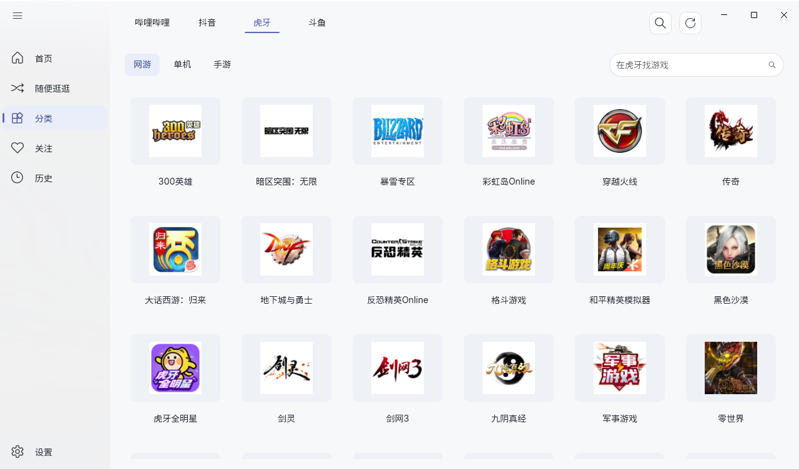
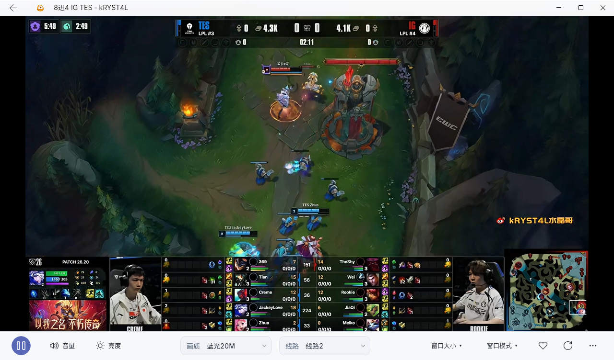

<p align="center">
  
</p>
<h1 align="center">YolanLive（游岚）</h1>

A focused Windows game livestream viewer for Bilibili, Douyin, Huya and Douyu, built with WinUI 3.

简洁的 Windows 游戏直播客户端。支持哔哩哔哩、抖音、虎牙和斗鱼，仅展示游戏分类，不显示弹幕。使用 WinUI 3，栏位采用磨砂材质，内容保持清晰。

**已发布版本：v1.1.7 · Windows x64 · MIT**

v1.1.7 修正播放器画质、线路标签与选中值的文字对齐，统一字号并保持垂直居中；项目介绍更新当前版本截图，图标放大居中。详见 [更新说明](RELEASE_NOTES.md) 和 [发布检查](docs/validation/release-1.1.7.md)。

## 下载

- [安装版 YolanLive-1.1.7-x64-Setup.exe](https://github.com/ShenShenSshen/YolanLive/releases/download/v1.1.7/YolanLive-1.1.7-x64-Setup.exe)
- [便携版 YolanLive-x64.zip](https://github.com/ShenShenSshen/YolanLive/releases/download/v1.1.7/YolanLive-x64.zip)
- [SHA-256 校验文件](https://github.com/ShenShenSshen/YolanLive/releases/download/v1.1.7/SHA256SUMS.txt)
- [所有发布版本](https://github.com/ShenShenSshen/YolanLive/releases)

GitHub 安装包无法下载时，可尝试公共加速：[线路一](https://gh-proxy.org/https://github.com/ShenShenSshen/YolanLive/releases/download/v1.1.7/YolanLive-1.1.7-x64-Setup.exe) / [线路二](https://ghfast.top/https://github.com/ShenShenSshen/YolanLive/releases/download/v1.1.7/YolanLive-1.1.7-x64-Setup.exe)。两者是第三方服务，请与正式发布的 SHA-256 核对。旧客户端先安装 v1.1.3 及以上版本，后续更新才会自动使用加速；公共源及 GitHub API 的可用性仍取决于网络。

安装版默认安装到当前用户目录，创建开始菜单入口，默认创建桌面快捷方式，可取消。便携版解压后运行 `YolanLive.exe`，请保留整个目录。

支持 Windows 10 1903（18362）及以上版本和 Windows 11 x64。抖音、虎牙、斗鱼网页登录及部分平台请求需要 WebView2 Runtime。程序自带 .NET 和 Windows App SDK 运行依赖，无需安装开发 SDK。

## 软件截图

### 首页


### 游戏分类



### 播放器



截图采集于 v1.1.7 隔离访客环境，展示当前字体、布局与真实平台内容，不含日常账号信息；直播内容与平台目录会随时间变化。

## 功能

- **四个平台，游戏优先**：按哔哩哔哩 / 抖音 / 虎牙 / 斗鱼切换首页和游戏分类；搜索、关注及历史统一管理。
- **浏览记忆与找游戏**：恢复最后的平台和各平台游戏大类；分类本地筛选当前平台游戏，卡片可直接固定最多 6 个常看游戏到首页。
- **清晰的搜索结果**：显示平台标识和接口已提供的开播状态，直播标题可悬停查看全文。
- **随便逛逛**：从四个平台游戏首页随机选择已开播房间，提供本轮上一个／下一个，记录末尾继续随机，切换保持当前播放器和窗口模式。
- **轻量播放器**：清晰度与线路切换、截图、全屏、置顶小窗、独立窗口播放；双击全屏、空格暂停，底栏调节音量与视频亮度；无边框模式支持按住视频拖动，控件自动隐藏。
- **有限断流恢复**：最多重试 3 次，重新检查房间及播放地址；确认停播时停止，离开房间取消。
- **浏览与播放窗口**：浏览时自由调整大小或最大化，返回恢复原窗口状态；播放保留 16:9 区域尺寸预设，主窗口和独立窗口分别记住位置。
- **关注与历史**：关注按直播中、未开播、状态待确认分组，历史按今天、昨天、更早分组，均支持本地筛选；刷新保留可见位置和键盘焦点。支持 JSON 导入导出。
- **账号登录**：哔哩哔哩扫码登录，抖音、虎牙、斗鱼使用各自官方网页登录，浏览器与加密会话分别保存；区分登录失效、网络失败与平台接口异常。
- **外观与更新**：浅色影音 / 深色主题、磨砂栏位，圆体大标题搭配更纱 UI SC 正文与导航，蓝青双色风翼图标；每次启动检测正式更新，设置支持后台下载、免费加速、失败换源及断点续传，校验后由用户启动安装器。
- **资源使用**：窗口位置及音量延迟 500 毫秒合并保存；日志按天或 10 MB 滚动、最多保留 7 份归档和 7 天；首页、分类详情和搜索每页最多保留 300 个直播条目。

公共数据请求复用连接、全应用最多并发 4 个，游戏目录缓存 10 分钟并合并重复加载；离开页面取消请求，最小化暂停列表检查。后台签名浏览器空闲后暂停或回收，图片按显示像素解码。实测方法、收益及限制见 [性能报告](PERFORMANCE_REPORT.md)。

没有弹幕、礼物效果或跨设备同步。


## 数据与升级

为兼容旧版本，软件继续使用 `%LOCALAPPDATA%\PlayWin` 与 `PlayWin.db`，这是保留登录会话、浏览器资料、关注及历史的存储身份；不会另建一套空数据。覆盖安装沿用原安装位置，新安装默认使用当前用户的 `Programs\YolanLive`。便携版请完整解压到新目录，运行 `YolanLive.exe`；不要混用新旧程序文件。

原仓库 [PlayWin](https://github.com/ShenShenSshen/PlayWin) 仅作为旧版升级入口，完整源码及历史发布移至 [YolanLive](https://github.com/ShenShenSshen/YolanLive)。旧版本可检测到最新正式版，下载文件仍以旧名提供，内容与新版安装器一致；升级后使用新仓库更新。

**卸载安装版会清空登录、关注、历史、设置、日志、下载文件及浏览器缓存，全部不保留**。程序和安装包暂未进行代码签名，Windows 可能显示未知发布者。

平台接口变化、平台登录要求和网络状况可能影响直播获取。视频保持原比例，不拉伸或裁切；直播源自身的黑边不会被去除。

## 构建与验证

需要 .NET 10 SDK、Windows SDK 10.0.26100.0；安装包另外需要 Inno Setup。

```powershell
.\build-winui.ps1
dotnet run --project tests/WinUIDataCheck/WinUIDataCheck.csproj -c Release
.\run-smoke-test.ps1
.\tests\UpdateCheck.ps1
.\build-installer.ps1 -CompilerPath '编译器目录\ISCC.exe'
```

解决方案：`YolanLive.slnx`。发布目录：`artifacts/YolanLive-win-x64`。

- `YolanLive.Core`：四个平台的接口与核心模型，项目文件 `YolanLive.Core.csproj`。
- `YolanLive.WinUI`：WinUI 3 客户端，项目文件 `YolanLive.csproj`。
- `tests`：数据、自检、图标和隔离安装验证。
- `installer/YolanLive.iss`：当前用户安装与卸载配置。

构建缓存、个人数据和发布产物不纳入源码。

每次发布 YolanLive 正式版后，必须同步旧 PlayWin 客户端的更新入口，防止旧版先安装中转版本。保留已发布安装包在 `artifacts` 下，使用已登录的 GitHub CLI 执行：

```powershell
.\sync-legacy-update.ps1
.\sync-legacy-update.ps1 -CheckOnly
```

脚本从 YolanLive 的最新正式发布读取版本，将同一安装包以旧客户端识别的 PlayWin 文件名发布到旧仓库；发布前后核对大小与 SHA-256，不覆盖历史正式包。旧版可一次覆盖升级至最新版，之后使用 YolanLive 更新源。

本次发布检查及限制见 [v1.1.7 发布检查](docs/validation/release-1.1.7.md)，更新下载的受控与实网结果见 [加速验证](docs/validation/update-acceleration.md)。测试使用 D 盘隔离访客目录，不读取日常账号。本轮不重复四平台全线路、150%/200% 实机缩放、系统高对比度切换及长期性能验收；既有窗口尺寸、虎牙线路等失败记录继续保留。程序和安装器仍未签名。

## 来源与许可证

设计参考项目：[https://github.com/xiaoyaocz/AllLive](https://github.com/xiaoyaocz/AllLive)。感谢原作者及项目依赖的维护者。

采用 [MIT 许可证](LICENSE)，保留原作者版权声明。与直播平台无官方关联。

虎牙播放令牌所需 Tars 编解码复用原项目中的平台无关代码，遵循 BSD 3-Clause。大标题与字标使用资源圆体，其他界面文字及数字使用 [更纱黑体 UI SC](https://github.com/be5invis/Sarasa-Gothic)，原字体及其他许可随程序携带；旧字体资源保留用于对照，不需要安装系统字体。

本地构建缓存默认放在项目的 artifacts/cache 下：nuget-packages 为本项目依赖，nuget-http 为下载缓存，temp 为编译、打包和自检临时文件。build-winui.ps1、build-installer.ps1、run-smoke-test.ps1 和隔离安装检查只在运行期间使用这些路径，不修改系统全局设置。直接运行 dotnet 命令时，项目依赖遵循 NuGet.Config；其他临时文件仍遵循当前终端的 TEMP/TMP 设置。
